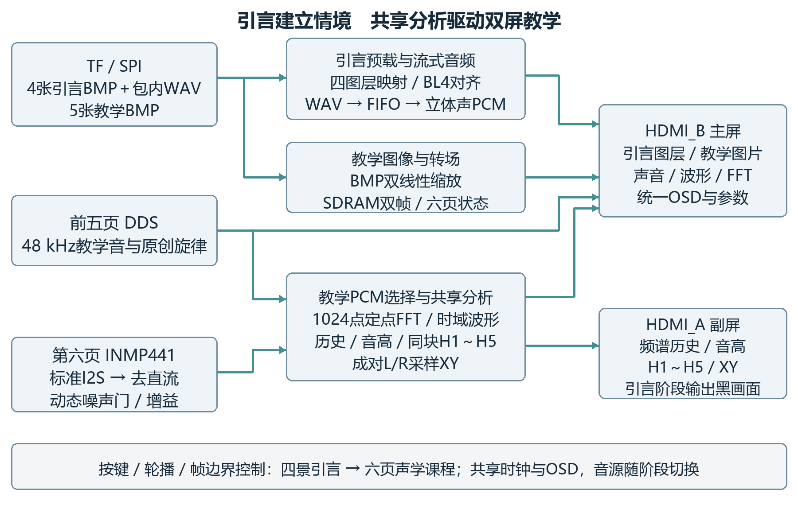
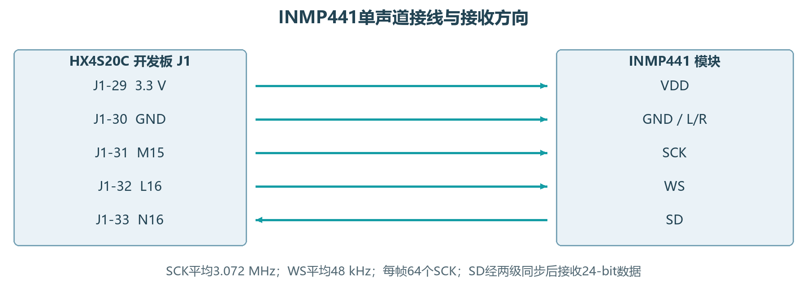
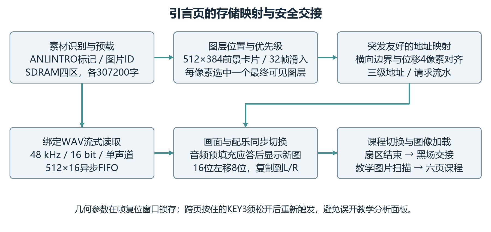
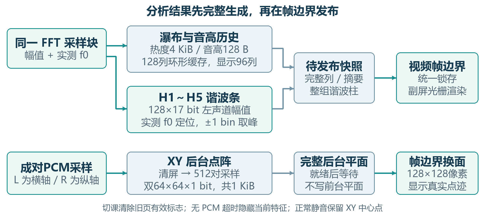
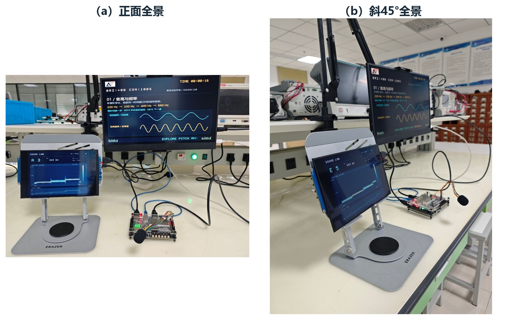
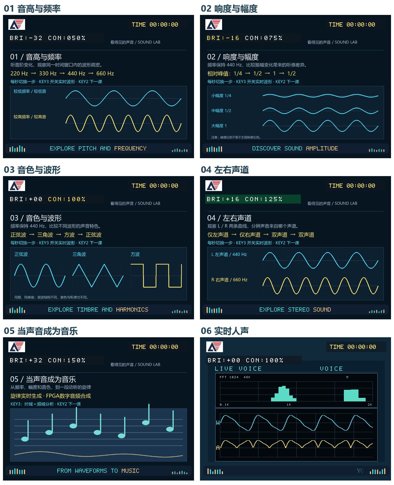
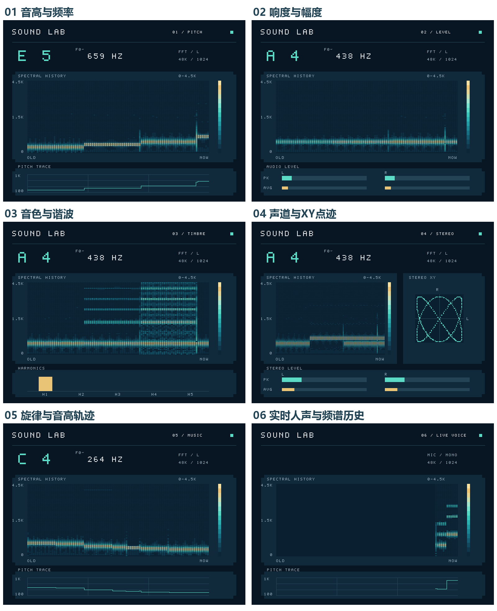
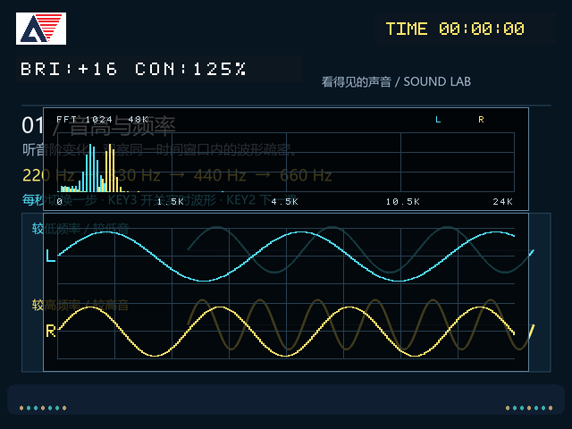
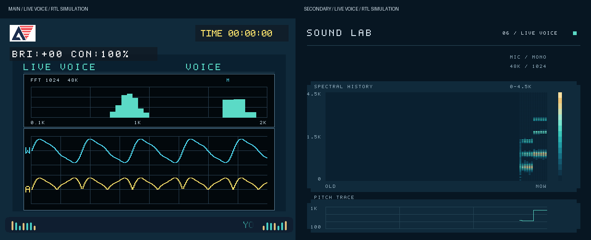

# 看得见的声音

基于安路 FPGA 的双屏声学可视化交互系统

> 双屏协同 · 声音可视化 · 交互教学

系统已完成烧录与上板测试。

## 使用入口

- [FPGA 工程文件](src/td_project/HDMI1.4b_Transmitter_v1.0.al)（Anlogic TD 6.2.168116）
- 准备[五张教学 BMP](doc/science_kiosk/bmp/)和[四张含配乐的 INTRO BMP](output/nature_intro_release/)；素材制作及存放方式见[说明](doc/nature_intro/README.md#tf-素材)。
- [下载系统 bit 文件](output/nature_intro_release/HDMI_nature_intro.bit)。
- 主屏连接 HDMI_B，副屏连接 HDMI_A；麦克风使用 INMP441。
- KEY1 复位；KEY2 短按切图、长按调节亮度；KEY3 在引言切图、课程页开关波形与 FFT；KEY4 短按切换轮播、长按调节对比度。

看得见的声音基于安路FPGA的可视化交互系统

## 摘要

作品面向声学课堂与科普展陈，以安路HX4S20C构建独立运行的双屏交互终端。开机先通过“大自然的声音”以TF读取四景图层动画和配乐引入，再进入音高、响度、音色、声道、原创旋律与实时人声六页课程。主屏负责互动演示，副屏同步显示频谱、音高和声道关系，形成“声临其境”般的交互过程。引言动画采用SDRAM四图预载与单像素优先级寻址、并按BL4对齐；教学阶段以同源PCM与1024点定点FFT驱动双屏，通过同块H1～H5、成对L/R采样XY及帧边界发布关联图形与实际信号。标准I2S人声前端复用共享分析链路，配合去直流、动态噪声门和增益控制。系统同时支持双线性缩放、字幕与Alpha叠加、转场及亮度、对比度调节。

## 第一部分  作品概述

### 1.1 功能与特性

上电先展示四景：首图全屏，后三图以80%原比例卡片从左、右、上方滑入，配乐与图片绑定。展示结束进入六页声学课程，主屏HDMI_B呈现图文、声音及KEY3控制的波形/FFT；副屏HDMI_A显示同源频谱历史、音高、H1～H5和XY。引入阶段副屏为黑画面，教学阶段进行同步分析。支持手动切换、自动轮播、动态时间与字幕、淡入淡出、亮度及对比度调节。

### 1.2 应用领域

适用于中小学声学课堂、科技馆互动展台和FPGA信号处理教学。引言图片与配乐既可用于展台暖场，也能直观展示系统的基础音视频播放能力；前五页通过可控的频率、幅度和波形建立直观对比，第六页支持现场麦克风发声互动。主副双屏分别显示操作引导与实时信号分析，方便课堂演示与多人围观。

### 1.3 主要技术特点

引言四图预载至SDRAM，按图层优先级计算每个像素的唯一读取地址，以4像素对齐适配BL4突发；WAV经异步FIFO接入HDMI音频链路。教学图像加载时完成双线性缩放，左右声道复用定点FFT，副屏被动读取分析结果。历史列、谐波组和XY平面完整后按帧提交；引言退出在扇区与帧边界交接，统一六页课程的切换顺序与按键操作。

### 1.4 主要性能指标

主要性能见表1-1，资源与时序见表3-3。

| 指标 | 参数 |
| --- | --- |
| 双屏 | 2×640×480；25 MHz；59.52 Hz |
| 音频 | 48 kHz、24 bit；MIC单声道 |
| 分析 | 1024点；46.875 Hz/bin；约33.6 ms/列 |
| 历史/特征 | 64带×96列；约3.23 s；H1～H5与XY |
| 实现裕量 | setup +0.163 ns；hold +0.003 ns |
| 引言 | 4景；32帧滑入；每景配乐8 s |

表1-1 主要性能指标

### 1.5 主要创新点

（1）情境引言：四景与WAV配乐同步切换，通过单像素优先级映射直接生成SDRAM突发地址，在不增加整帧缓存的前提下实现多卡片平滑滑入。

（2）一核双屏：左右声道时分复用单核1024点FFT，副屏直接提取瀑布图、同块H1～H5谐波与双声道XY李萨如图。

（3）现场参与：设计独立I2S人声接收与自适应双阈值噪声门，消除底噪抖动，并按视频帧边界同步刷新双屏分析图形。

### 1.6 设计流程

赛题与接口核对 → 规划情境引言与六页课程 → 设计TF/BMP、SDRAM及HDMI音视频链路 → 实现图层动画、配乐、双屏分析与人声交互 → 完成功能联调、布局布线及整机演示。

## 第二部分  系统组成及功能说明

系统由启动引言和六页教学两个阶段组成，主状态机统一调度图像加载、音源切换与双屏显示，系统架构见图2-1。

### 2.1 整体介绍

引言阶段预载四张场景图并流式读取绑定WAV，主屏呈现图层动画，副屏保持黑画面。退出时完成SD总线与黑场交接，进入教学第一页；后续轮播在六页内循环。前五页由DDS合成教学音，第六页选取麦克风PCM并保持HDMI音频静音；两屏复用教学分析结果。TF卡保存教学BMP及四个INTRO素材包，人声背景由逻辑生成。

*图2-1 引言与六页教学的音源、图像及双屏路径*

### 2.2 硬件系统介绍

#### 2.2.1 硬件整体介绍

采用HX4S20C开发板和板载EG4S20BG256，使用50 MHz参考时钟、TF/SPI、SDRAM、双HDMI及扩展口INMP441。主要时钟为SD/BMP 100 MHz、SDRAM 40 MHz及相移时钟、视频25 MHz、HDMI串行125 MHz。两路视频均为640×480，共用25/125 MHz显示时钟；引言音频经100/25 MHz异步FIFO接入HDMI_B，共用PLL时钟。

#### 2.2.2 机械设计介绍

采用开发板和外接双显示器搭建演示终端。主显示器尺寸为15.6英寸，双声道扬声器；副显示器为10英寸。

#### 2.2.3 电路各模块介绍

板载TF/SPI读取图片和WAV，SDRAM保存引言四图或教学双帧，TMDS分别送两路HDMI。KEY1复位；KEY2短按切图/翻页、长按调亮度；KEY4短按轮播、长按调对比度，KEY2+KEY4长按恢复参数。KEY3在引言中切图，进入教学后控制波形与FFT；跨页按住须松开后重新触发。麦克风接线见图2-2，L/R接地选择左声道。

*图2‑2 麦克风关键输入输出与接线示意*

### 2.3 软件系统介绍

#### 2.3.1 软件整体介绍

运行逻辑由可综合HDL状态机实现，系统独立运行。引言配乐从TF卡读取，48 kHz、16-bit单声道转换为双声道24-bit PCM。教学前五页使用DDS，第五页为120 BPM、8 s的17音符原创旋律，自动轮播等待乐句结束；第六页接入麦克风分析。PC用于素材打包、构建和烧录。

#### 2.3.2 软件各模块介绍

表2-1列出关键输入、处理与输出；情境引言流程见图2-3，随后说明图像、共享分析和人声算法。

| 模块 | 关键输入 | 主要处理 | 关键输出 |
| --- | --- | --- | --- |
| 引言控制 | 按键/VS、就绪应答 | 切图、分层位置、黑场交接 | photo/slide/exit |
| WAV前端 | 包内WAV、图片ID | 流式读取、异步FIFO | 48 kHz双声道PCM |
| TF/BMP | 扇区、BMP头 | 格式校验、双线性缩放 | 640×480像素流 |
| 缓冲/转场 | 像素、切页请求 | 双帧缓存、淡出/黑场/淡入 | 稳定帧、提交页码 |
| DDS / I2S | 页码、采样使能 | 教学音合成、I2S解码 | 48 kHz立体声PCM |
| MIC前端 | SCK/WS/SD、页码 | 标准I2S、去直流、噪声门、增益 | 单声道分析PCM |
| 共享FFT | 选定PCM高16位 | Hann窗、1024点FFT、L/R复用 | 原始幅值、频带高度 |
| 历史/音高 | 幅值、页码 | 环形历史、主峰插值、PK/AVG | 瀑布、轨迹、幅值 |
| 谐波 / XY | 同块频率与幅值、成对PCM | 谐波定位、归一化、后台点阵 | 第三/四页专属视图 |

表2-1 软件模块输入、处理与输出

引言图层与突发映射。四张带ANLINTRO标记和ID的素材预载到SDRAM四个区域，每区307200个32-bit字。首图全屏，后三图离线双线性缩放为512×384卡片，分别从左、右、上方用32帧滑入，下层场景保留。渲染时按优先级为每个像素选择一个可见图层，其地址为：

$A = 307200b + 640{y}_{s} + {x}_{s}$

其中b为图层编号0～3，xₛ、yₛ为该图层的源坐标。横向边界与位移按4像素对齐，每组四像素映射为四个连续且4字对齐的地址，适配SDRAM的BL4突发。地址与读请求经同一三级流水输出，几何参数在帧复位窗口锁存，不增加片上整帧缓存。

图片读取。TF卡内BMP符合赛题要求，同时播放每段配乐，为48 kHz、16-bit单声道、8 s；数据经512×16异步FIFO输出，左移8位并复制到L/R接入HDMI音频链路。

阶段控制与交接。素材就绪后请求当前配乐，FIFO预填充应答后提交图片；自动模式每景停留480帧（约8 s），滑入过程单独计时。第四景结束后在SD扇区结束与黑场阶段交接，启动教学图片扫描。几何、事件和载荷通过同步器与稳定载荷握手跨域，最终36个几何/模式同步寄存器连接已按网表核对。

*图2-3 引言素材、图层映射、音频同步及教学交接*

FFT与定点幅值。结合FFT硬件资源权衡[7–9]，将24-bit PCM截为Q1.15，乘Q0.15周期Hann窗后执行10级Radix-2 DIT[5–6]，每级除以2并饱和，L/R时分复用。幅值采用|Re|+|Im|近似，聚合成每声道128带并作近似对数高度映射，供两屏复用。采样率fₛ=48 kHz、点数N=1024时，单窗口采集21.333 ms；频点间隔与峰值插值估计如下。

$\Delta f = \frac{f_s}{N} = \frac{48000}{1024} = 46.875\,\mathrm{Hz}$

$\hat{f} = (k_p + \delta)\Delta f,\quad |\delta| \leq 0.5$

图像与转场。解析24-bit BI_RGB BMP的宽高、行方向、像素偏移及4字节行补齐[4]，使用两行缓存和8-bit小数权重完成双线性缩放；支持宽高各1～2048像素，输出固定640×480。素材连续扇区存放。SDRAM双帧交换配合16帧淡出、至少2帧黑场和16帧淡入；黑场提交页码，DDS在立体声帧边界重启。亮度/对比度定点乘加后饱和至0～255，RGB与SOF/TLAST同步流水，确保每行640个有效像素。

历史与音高。副屏取低频64带：前32带各1 bin、后32带各2 bin，分段线性覆盖约0～4.5 kHz，L/R取较大值后量化为16级热度。4 KiB环形缓存含128列、显示96列，约33.6 ms更新一列，历史跨度约3.23 s。单主峰搜索bin 2～511，采用一次三点抛物线插值，δ限制在±0.5 bin；幅值门限和相邻帧平滑抑制跳变。前五页映射C2～B6，轨迹范围100～1000 Hz。插值思路参考[10–11]；整数Hz显示不代表1 Hz分辨率，AVG表示平均绝对幅值。

同块H1～H5。第三页缓存左声道前128个17-bit幅值，以同一FFT块实测基频定位五阶谐波，在最近频点±1 bin取峰，再以H1归一化到0～38像素。仅在100～1000 Hz且幅值有效时发布。常数减法与38次分数累加替代变量宽除法，处理上界650个25 MHz周期，即26 μs；专用存储占1块BRAM，无额外DSP。

成对PCM的XY点迹。第四页将同一有效时刻的L/R高8位映射至64×64坐标，对称裁剪至−31～31；每面采集512对样本，历时10.67 ms。两个单比特平面共1 KiB、占1块BRAM，完整采集后按帧换面，显示放大为128×128像素。单左/单右对应水平/竖直点迹，L440 Hz与R660 Hz形成2∶3轨迹，图形由实际采样生成。

标准I2S接收。INMP441采用24-bit标准I2S接口[12]，每声道32个SCK、每帧64个SCK，WS翻转后延迟一拍接收MSB。独立接收器使用25 MHz分数累加器产生平均3.072 MHz SCK与48 kHz WS，半周期160/200 ns，共用视频域时钟；SD两级同步，启动丢弃4096帧约85.33 ms。与教学音I2S接收器分开，避免字槽协议不同引起错位。

人声去直流与动态门控。直流跟踪采用Q24.8、系数1/1024，减去缓变偏置得到${x}_{c}$。每256点计算块b的平均绝对幅值${A}_{b}$，以静音时更新、开门时冻结的底噪${N}_{b}$生成双阈值；${N}_{b}$限制在128～1024原始PCM单位。连续2个窗口越过开门阈值后放行，连续18个窗口低于关门阈值后关闭，名义时间分别为10.67 ms与96 ms。

${A}_{b} = \frac{\sum |{x}_{c}[n]|}{256},\quad {T}_{on} = \max(768, 3{N}_{b}),\quad {T}_{off} = \max(384, 2{N}_{b})$

增益与人声视图。开门后按8～128倍的2次幂增益放大，过载快速降档、每1024个有效人声样本允许升档，并作24-bit饱和；静音期保持固定增益16和连续有效零PCM。主屏聚焦约100～2000 Hz，副屏保留约0～4.5 kHz瀑布并标记MIC/MONO，移除数值音名、Hz及PK面板；底部轨迹仅作主峰变化观察。门控改善静音时的显示稳定性。

帧边界发布。历史按完整列、谐波按整组、XY按完整平面发布；副屏RGB与SOF/TLAST保持两拍对齐。切源使混合窗口及旧结果失效，约250 ms无PCM时隐藏当前特征；有效零PCM仍推进FFT和历史。主屏Logo、动态时间、参数、Alpha字幕与两端律动在六页共享，人声页可隐藏低于8像素的弱频谱条以抑制静音残影。

*图2-4 同块特征关联与帧边界发布机制*

## 第三部分  完成情况及性能参数

系统已完成烧录和上板验证。以下以实物、界面和匹配构建报告展示成果。

### 3.1 整体介绍

实物系统由HX4S20C开发板、TF卡、INMP441和两台HDMI显示器组成。主屏承担情境引入、课程引导与即时反馈，副屏在教学阶段呈现频谱历史和信号特征；通过板载按键完成切换、轮播及显示调节。

*图3-1 系统实物正面与斜45°全景*

### 3.2 工程成果

#### 3.2.1 机械成果

以开发板和外接双屏组成演示终端，如图3-1所示。15.6英寸主屏带双声道扬声器，通过可调机械臂固定于上侧；10英寸副屏位于左下侧，采用独立支架。

#### 3.2.2 电路成果

电路由开发板TF/SPI、SDRAM、双HDMI和3.3 V INMP441扩展接口组成。图层映射、WAV读取、教学合成与信号分析共用存储、时钟及音视频输出通道。

#### 3.2.3 软件成果

表3-1汇总引言与六页课程。图3-2展示四景引言，图3-3、图3-4展示教学主副屏，图3-5、图3-6分别展示KEY3分析及实时人声联动。界面图为RTL预览，实物见图3-1。

| 页面 | 声音与主屏 | 副屏与教学目标 |
| --- | --- | --- |
| 引言（启动） | 四景分层滑入；4段8 s配乐；KEY2/KEY3切图 | 副屏黑画面；第四景后进入教学第一页 |
| 1 音高 | 220→330→440→660 Hz正弦；源图640×480 | 频谱脊线与音高阶梯：频率决定音高 |
| 2 响度 | 440 Hz；峰值1/4→1/2→1→1/2；源图800×600 | L/R的PK/AVG随幅度变化，区分幅度与频率 |
| 3 音色 | 440 Hz正弦→三角→方波→正弦；源图1024×768 | 同块H1～H5及瀑布对比谐波分量构成 |
| 4 声道 | 单左→单右→双声道；L440/R660 Hz；源图1280×960 | 左右电平幅值与2：3李萨如图展示双声道相位及频率关系 |
| 5 旋律 | 120 BPM、17音符、8 s原创旋律；源图960×720 | 瀑布与音高轨迹呈现音符变化，自动等待乐句结束 |
| 6 人声 | INMP441单声道；逻辑背景、波形与约100～2000 Hz频谱 | MIC/MONO、频谱历史与主峰轨迹；现场声音直接参与 |

表3-1 引言、六页功能与双屏教学对应关系

*图3-2 “大自然的声音”四景与分层滑入效果*

*图3-3 六页教学主屏界面概览*

*图3-4 六页教学副屏功能概览*

*图3-5 KEY3开启后的主屏波形与FFT分析（第一页示例）*

*图3-6 第六页实时人声的主副屏协同*

### 3.3 特性成果

基础功能1~4、扩展1～5、双屏分析和四景引言集成于同一工程，完成情况见表3-2。

| 类别 | 项目 | 功能 | 完成情况 |
| --- | --- | --- | --- |
| 基础功能 | 图片读取 | TF/SPI读取24位BMP，经SDRAM缓存并由HDMI显示 | 已完成 |
| 基础功能 | 图片切换 | 支持按键手动切换和自动轮播，画面连续稳定，无明显闪烁或异常 | 已完成 |
| 基础功能 | 音频输出 | HDMI输出48 kHz音频，音画类型随不同主题切换 | 已完成 |
| 基础功能 | 固化与稳定 | Flash固化，脱离PC启动长时间稳定运行 | 已完成 |
| 扩展功能 | 扩展一 叠加 | 图层叠加，logo与时间信息，下方滚动字幕 | 已完成 |
| 扩展功能 | 扩展二 转场 | SDRAM双缓冲，图片滑动进入，教学页图片淡入淡出画面连续无撕裂。 | 已完成 |
| 扩展功能 | 扩展三 缩放 | 变尺寸24位BMP解析，不同分辨率双线性缩放至640×480 | 已完成 |
| 扩展功能 | 扩展四 调节 | 按键实时调节亮度、对比度，画面呈现参数变化信息 | 已完成 |
| 扩展功能 | 扩展五 音频 | 播放PCM驱动时域波形与1024点FFT频谱，增加可视化效果 | 已完成 |
| 创新设计 | 双屏协同 | 主屏展示与播放，副屏显示同源实时分析功能 | 超额完成 |
| 创新设计 | 真实频谱 | 共享PCM/FFT，生成瀑布图与音高轨迹 | 超额完成 |
| 创新设计 | 科普课程 | 五课教学音源与原创旋律，课程页音画同步，字幕两侧呈现音乐呼吸可视化效果，生动有趣 | 超额完成 |
| 创新设计 | 谐波分析 | 同一FFT块计算H1-H5相对幅值 | 超额完成 |
| 创新设计 | 声道关系 | 真实左右PCM驱动立体声+XY李萨如图，加强不同声道音频展示效果 | 超额完成 |
| 创新设计 | 实时声音输入 | INMP441麦克风输入采样分析（标准I2S：24位、64SCK/帧） | 超额完成 |
| 创新设计 | 人声增强 | 自适应噪声门与主屏约0.1-2 kHz频谱聚焦 | 超额完成 |

表3‑2 赛题功能、创新功能及完成情况

表3-3对应HDMI_nature_intro.bit，采用TD 6.2.168116于2026年10月31日生成的最终布局布线数据。

| 资源或检查项 | 最终结果 | 说明 |
| --- | --- | --- |
| LUT / REG | 16,841/19,600（85.92%）；9,507/19,600（48.51%） | 系统完整布局布线 |
| BRAM / DSP / PLL | 64/64（100%）；26/29（89.66%）；3/4 | 图层与音频缓存纳入统一资源配置 |
| 全局setup / hold | SWNS +0.163 ns；STNS 0；HWNS +0.003 ns；HTNS 0 | 慢角与快角检查；STA覆盖96.02% |
| 主要时钟组setup | 视频 +1.656 ns；SD +0.163 ns；SDRAM +1.801 ns；串行 +5.606 ns | 25 / 100 / 40 / 125 MHz |

表3-3 系统资源与布局布线时序

## 第四部分  总结

### 4.1 可扩展之处

后续可在两方面继续完善：一是开放TF卡课程配置文件，允许教师自定义音频参数与背景图，或用于听障辅助教学中的发音视觉反馈；二是在算法上增加复音基频提取、总谐波失真（THD）计算及音频录制回放功能，并进一步压缩SDRAM带宽占用。

### 4.2 心得体会

在最初搭建系统时，我们只规划了音高、响度和音色等基础单音演示。但在板级调试DDS模块时发现，单纯播放固定频率的正弦波比较枯燥，于是顺势加入了节拍与音符频率查找表，用一段8秒的合成旋律把前面的声学知识点串联起来；后来为了让展台演示更有参与感，又在安路开发板的扩展引脚接上了INMP441麦克风，把单纯的“看和听”改造成了可以现场对着麦克风说话、拍手的实时交互。

真正动手把这些想法塞进同一颗FPGA时，才发现处处是时序和资源的硬骨头。比如开机四景滑入动画，如果用传统画布拼接，片上BRAM根本不够用，最后我们改为在读取端实时计算像素优先级，并将坐标强制按4像素对齐来匹配SDRAM的BL4突发，才解决了画面撕裂和带宽瓶颈。在调试麦克风页面时，环境底噪常导致副屏音高轨迹剧烈乱跳，我们先后尝试了固定阈值和滑动平均，最终通过引入静音底噪跟踪与双阈值噪声门，并把所有特征统一锁存到视频帧边界刷新，才让双屏画面彻底稳定下来。

后期为了在85%以上的LUT占用率下收敛时序，我们把原本打算用除法器实现的谐波归一化改成了常数减法与38次分数累加，一点点抠出了+0.163 ns的建立时间裕量。这次开发让我们深刻体会到，好的工程作品不仅需要贴合场景的交互构思，更依赖底层跨时钟域握手、存储对齐和定点算法上的死磕。

此外，这次高强度的开发也让我们对安路HX4S20C开发板与TD（Tang Dynasty）6.2.1软件的成熟度有了切身体会。随着各种模块的叠加，工程的片上 BRAM 占用率达到了 100%，DSP 与 LUT 也分别用到了 89.66% 和 85.92%。原本我们非常担心在如此极限的资源利用率下会出现布线拥塞或时序违例，但 EG4S20芯片与TD 6.2.1综合布线引擎表现得非常稳健，在25/40/100/125 MHz 多时钟域交织的条件下依然顺利完成了布局布线，并给出了清晰的时序分析报告，帮助我们精准定位关键路径、收敛出+0.163ns的建立时间裕量。板载的合封 SDRAM与双路HDMI接口也为双屏音视频同步提供了扎实的硬件底座，让我们真切感受到了国产FPGA软硬件平台在复杂数字系统开发中的高可靠性与易用性。

## 第五部分  参考文献

[1] 安路科技. FPGA创新设计竞赛：FPGA创新设计赛题一[Z]. 2026.

[2] 安路科技. HX4S20C开发板使用手册（HDL-2410）[Z]. 2024.

[3] 安路科技. HDMI 1.4b Transmitter IP用户手册（APUG092）[Z].

[4] Microsoft. Bitmap Storage[EB/OL]. (2022-11-18)[2026-10-30]. https://learn.microsoft.com/en-us/windows/win32/gdi/bitmap-storage.

[5] Cooley J W, Tukey J W. An Algorithm for the Machine Calculation of Complex Fourier Series[J]. Mathematics of Computation, 1965, 19(90): 297–301.

[6] Harris F J. On the Use of Windows for Harmonic Analysis with the Discrete Fourier Transform[J]. Proceedings of the IEEE, 1978, 66(1): 51–83.

[7] Garrido M. A Survey on Pipelined FFT Hardware Architectures[J]. Journal of Signal Processing Systems, 2022, 94: 1345–1364. DOI:10.1007/s11265-021-01655-1.

[8] Kaya Z, Garrido M, Takala J. Memory-Based FFT Architecture With Optimized Number of Multiplexers and Memory Usage[J]. IEEE Transactions on Circuits and Systems II: Express Briefs, 2023, 70(8): 3084–3088. DOI:10.1109/TCSII.2023.3245823.

[9] Yang C, Wu J, Xiang S, et al. A High-Throughput and Flexible Architecture Based on a Reconfigurable Mixed-Radix FFT With Twiddle Factor Compression and Conflict-Free Access[J]. IEEE Transactions on Very Large Scale Integration (VLSI) Systems, 2023, 31(10): 1472–1485. DOI:10.1109/TVLSI.2023.3298943.

[10] Wei M, Zhang A, Qi L, et al. An Efficient Frequency Estimator for a Complex Exponential Signal Based on Interpolation of Selectable DTFT Samples[J]. Sensors, 2022, 22(3): 861. DOI:10.3390/s22030861.

[11] Togni A, Zannoni M, Tortora P. Accurate Frequency Estimation Through Iterative Parabolic Interpolations[J]. Signal Processing, 2025, 237: 110094. DOI:10.1016/j.sigpro.2025.110094.

[12] InvenSense. INMP441 Omnidirectional Microphone with Bottom Port and I²S Digital Output: DS-INMP441-00, Rev. 1.1[EB/OL]. (2014-05-21)[2026-10-30]. https://product.tdk.com/system/files/dam/doc/product/sw_piezo/mic/mems-mic/data_sheet/inmp441.pdf.

## 开源协议

本项目采用 [MIT License](LICENSE)，第三方内容说明见 [THIRD_PARTY_NOTICES.md](THIRD_PARTY_NOTICES.md)。
