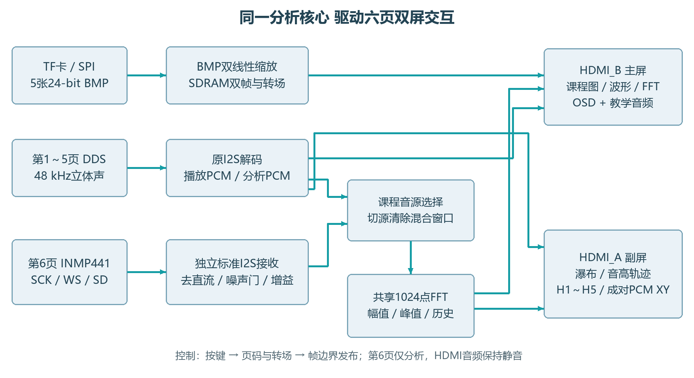
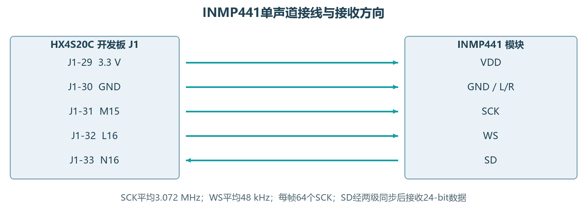
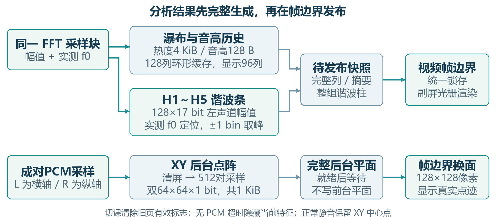
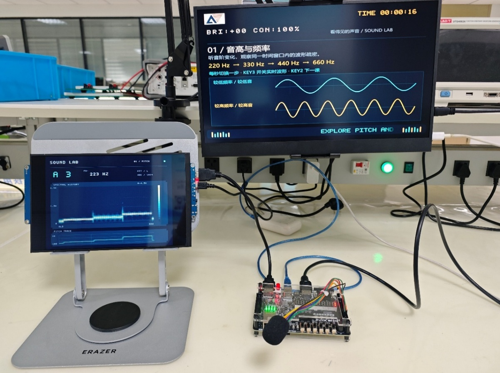
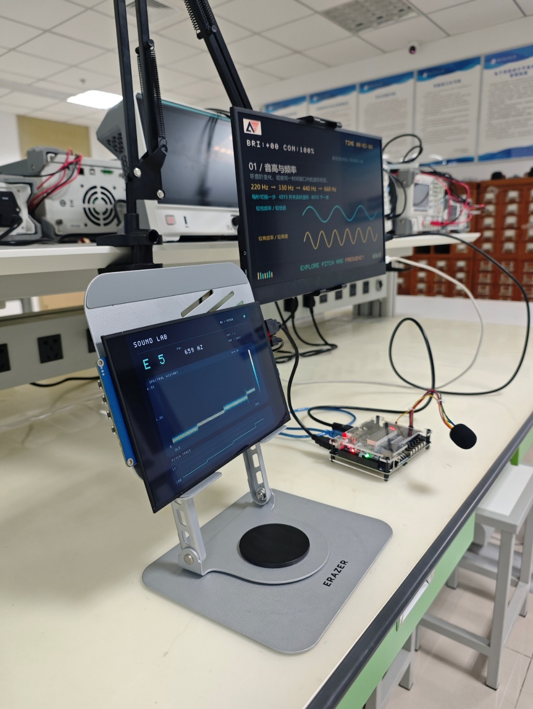
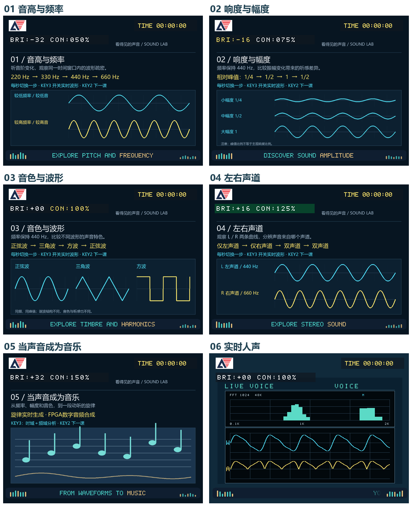
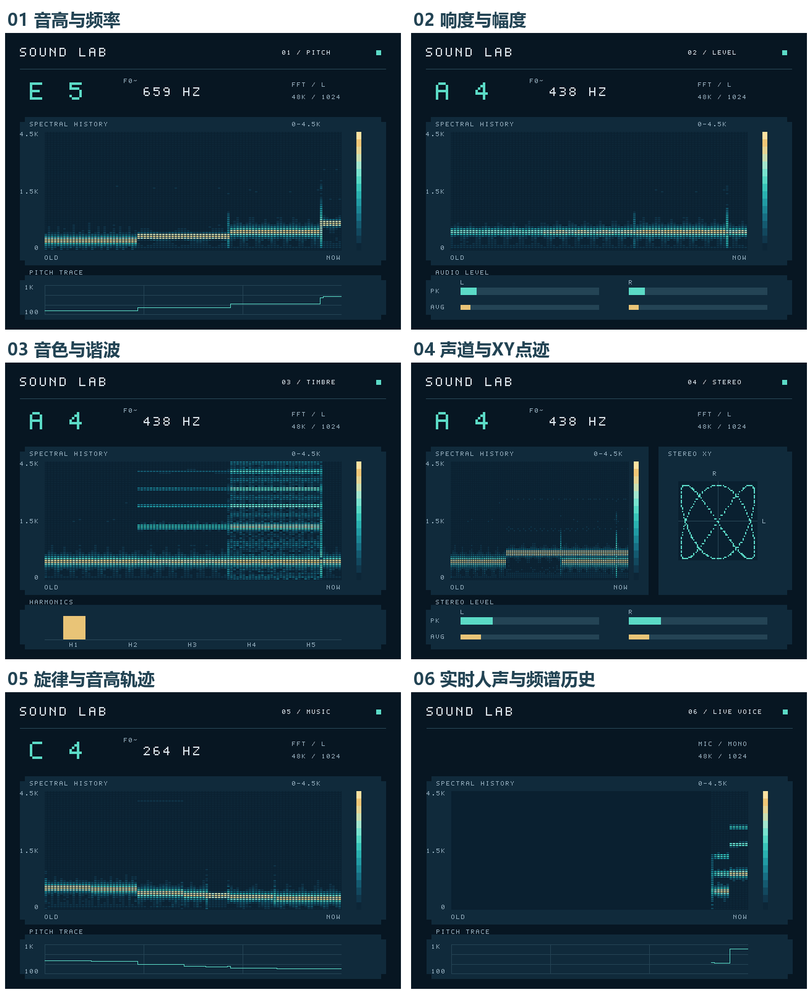
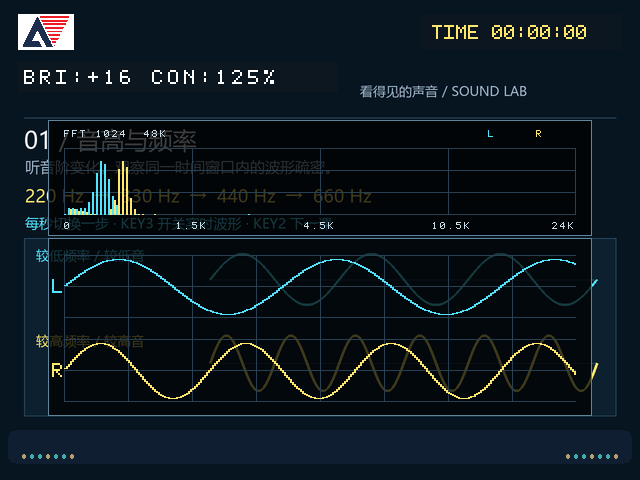
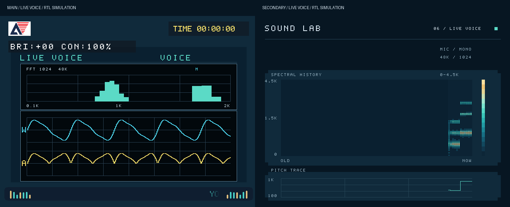

# 看得见的声音

基于安路 FPGA 的可视化交互系统

> 六页声学课程 · 双屏同步分析 · FPGA 旋律合成 · 实时人声参与

面向声学课堂与科普展陈的独立双屏终端：主屏展示课程、声音与即时波形，副屏呈现频谱历史、音高、谐波和声道关系。**当前六页工程已完成烧录与上板测试。**

[快速运行](#快速运行) · [作品概述](#作品概述) · [系统组成及功能说明](#系统组成及功能说明) · [完成情况及性能参数](#完成情况及性能参数) · [总结](#总结) · [参考文献](#参考文献) · [开源协议](#开源协议)

## 快速运行

1. 准备 HX4S20C 开发板、FAT32 TF 卡、两台 HDMI 显示器和 INMP441。主屏接 **HDMI_B**，副屏接 **HDMI_A**；麦克风接线见下文图2-2。
2. 使用 **Anlogic TD 6.2** 打开[工程文件](src/td_project/HDMI1.4b_Transmitter_v1.0.al)，目标器件为 **EG4S20BG256**，归档工具版本为 **6.2.168116**。
3. 按[素材与存放说明](doc/science_kiosk/第五页音乐扩展说明.md)准备[五张 BMP](doc/science_kiosk/bmp/)，按课程顺序连续存放。第六页背景由逻辑生成，教学音和旋律由 FPGA 合成，无需复制 WAV。
4. 下载[当前六页统一 Logo 版 bit](doc/logo_overlay/HDMI_anlogic_logo.bit)，或由工程重新构建后下载。

| 按键 | 操作 |
| --- | --- |
| KEY1 | 复位 |
| KEY2 | 短按下一页，长按调节亮度 |
| KEY3 | 同时显示或隐藏主屏波形与 FFT 面板 |
| KEY4 | 短按切换自动轮播，长按调节对比度 |
| KEY2 + KEY4 | 同时长按，恢复默认显示参数 |

## 摘要

作品面向声学课堂与科普展陈，以安路HX4S20C构建独立运行的双屏交互终端。主屏呈现课程、声音与即时波形，副屏解释频谱、音高和声道关系；六页由音高、响度、音色、立体声、原创旋律递进至实时人声，形成“听示例—看规律—用自己的声音验证”的学习闭环。系统以同一PCM和1024点定点FFT驱动两屏，采用同块H1～H5谐波提取、成对L/R采样XY点迹、帧边界快照及低存储历史绘图。第六页通过独立标准I2S接收、去直流、自适应噪声门与增益控制，将真实人声接入既有分析链路，无需复制FFT或增加PLL。五张不同尺寸BMP经双线性缩放显示，支持字幕、Alpha叠加、淡入淡出、亮度与对比度调节。当前六页工程已完成烧录和上板测试。

## 作品概述

### 1.1 功能与特性

主屏HDMI_B展示课程并播放教学音，KEY3联动时域波形与FFT；副屏HDMI_A持续显示同源分析。六页覆盖音高、响度、音色、声道、旋律和实时人声：H1～H5解释音色，XY揭示双声道关系，人声页让观众直接参与。支持按键切页、自动轮播、动态时间与字幕、淡入淡出，以及亮度/对比度调节；统一使用安路图形Logo。

### 1.2 应用领域

适用于中小学声学课堂、科技馆互动展台和FPGA信号处理教学。前五页以可控频率、幅度、波形和声道建立直观对照，第六页采集现场说话或哼唱，观察即时波形与频谱历史。双屏将教学引导与数据解释并置，便于教师讲解、观众操作和多人同步观察。

### 1.3 主要技术特点

图像在加载阶段完成解析与双线性缩放，显示阶段顺序读SDRAM；左右声道复用定点FFT，副屏被动读取分析结果。增加麦克风使用独立标准I2S前端，音源选择与窗口失效联动，防止跨源混算。历史列、谐波组与XY平面完整后按帧提交，六页共用控制、OSD和显示时钟。

### 1.4 主要性能指标

主要性能见表1-1，详细资源和时序列于表3-3。

| 指标 | 参数 |
| --- | --- |
| 双屏 | 2×640×480；25 MHz；59.52 Hz |
| 音频 | 48 kHz、24 bit；MIC单声道 |
| 分析 | 1024点；46.875 Hz/bin；约33.6 ms/列 |
| 历史/特征 | 64带×96列；约3.23 s；H1～H5与XY |
| 实现裕量 | setup +0.101 ns；hold +0.004 ns |

*表1-1 主要性能指标*

### 1.5 主要创新点

（1）一核双屏：同源PCM与FFT同时支撑教学展示和数据解释，不复制分析核心。

（2）可追溯特征：同块实测频率定位H1～H5，成对PCM直接生成XY，揭示音色和声道关系。

（3）人声参与：独立I2S、动态噪声门和增益复用原分析链路；4 KiB历史与1 KiB XY缓冲兼顾交互和资源。

### 1.6 设计流程

赛题与接口核对 → 打通TF/BMP、SDRAM和HDMI音视频 → 完成扩展1～5与五页课程 → 复用PCM/FFT实现副屏 → 加入同块谐波、XY与第六页人声 → 回归、布局布线及bit归档 → 烧录与上板测试。

## 系统组成及功能说明

课程状态统筹图像、声音和分析，双屏共享数据与控制，整体关系见图2-1。

### 2.1 整体介绍

前五页由DDS合成教学音，经原I2S链路播放并分析；第六页选择麦克风PCM参与分析，HDMI音频保持静音。TF卡仅存五张BMP，人声背景由逻辑生成。主屏提交课程页码后，副屏在帧边界同步；切页或切源清除未完成窗口及旧特征有效标志。分析支路不反压播放，也不接管FFT应答。



*图2-1 六页音源、双屏分工及共享分析路径*

### 2.2 硬件系统介绍

#### 2.2.1 硬件整体介绍

采用HX4S20C开发板和板载EG4S20BG256，使用50 MHz参考时钟、TF/SPI、SDRAM、双HDMI及扩展口INMP441。主要时钟为SD/BMP 100 MHz、SDRAM 40 MHz及相移时钟、视频25 MHz、HDMI串行125 MHz。两路视频均为640×480；HDMI_B兼容教学音频输出，HDMI_A仅输出分析视频，共用25/125 MHz显示时钟。

#### 2.2.2 机械设计介绍

采用开发板和外接双显示器搭建演示终端。主显示器尺寸为15.6英寸，双声道扬声器；副显示器为10英寸。

#### 2.2.3 电路各模块介绍

板载TF/SPI提供扇区数据，SDRAM完成双帧读写，TMDS差分信号分别送两路HDMI。KEY1复位；KEY2短按切页、长按调亮度；KEY3联动波形与FFT面板；KEY4短按轮播、长按调对比度，组合键恢复参数。按键经消抖和跨时钟同步，参数在帧边界生效。麦克风关键连线见图2-2：FPGA输出SCK/WS、输入SD，L/R接地选择左声道，电源为3.3 V。



*图2-2 麦克风关键输入输出与接线示意*

### 2.3 软件系统介绍

#### 2.3.1 软件整体介绍

运行逻辑由可综合HDL状态机实现，系统不依赖PC或云端。前五页DDS提供可控教学音，第五页为120 BPM、8 s的17音符原创旋律；自动轮播等待乐句结束，手动切页可中断。第六页读取麦克风，不播放麦克风回声；退出后恢复DDS。PC用于素材准备、构建和烧录。

#### 2.3.2 软件各模块介绍

表2-1列出各模块关键输入、处理和输出；算法按图像、共享分析与人声接入顺序说明。

| 模块 | 关键输入 | 主要处理 | 关键输出 |
| --- | --- | --- | --- |
| TF/BMP | 扇区、BMP头 | 格式校验、双线性缩放 | 640×480像素流 |
| 缓冲/转场 | 像素、切页请求 | 双帧缓存、淡出/黑场/淡入 | 稳定帧、提交页码 |
| DDS / I2S | 页码、采样使能 | 教学音合成、原I2S解码 | 48 kHz立体声PCM |
| MIC前端 | SCK/WS/SD、页码 | 标准I2S、去直流、噪声门、增益 | 单声道分析PCM |
| 共享FFT | 选定PCM高16位 | Hann窗、1024点FFT、L/R复用 | 原始幅值、频带高度 |
| 历史/音高 | 幅值、页码 | 环形历史、主峰插值、PK/AVG | 瀑布、轨迹、幅值 |
| 谐波 / XY | 同块频率与幅值、成对PCM | 谐波定位、归一化、后台点阵 | 第三/四页专属视图 |

*表2-1 软件模块输入、处理与输出*

**FFT与定点幅值。**结合FFT硬件资源权衡[7–9]，将24-bit PCM截为Q1.15，乘Q0.15周期Hann窗后执行10级Radix-2 DIT[5–6]，每级除以2并饱和，L/R时分复用。幅值采用|Re|+|Im|近似，聚合成每声道128带并作近似对数高度映射，供两屏复用。采样率fₛ=48 kHz、点数N=1024时，单窗口采集21.333 ms；频点间隔与峰值插值估计如下。

$$
\Delta f = \frac{f_{s}}{N} = \frac{48\,000}{1024} = 46.875\,\mathrm{Hz}
$$

$$
\hat{f} = (k_{p} + \delta ) \Delta f,\quad  |\delta | \le  0.5
$$

**图像与转场。**解析24-bit BI_RGB BMP的宽高、行方向、像素偏移及4字节行补齐[4]，使用两行缓存和8-bit小数权重完成双线性缩放；支持宽高各1～2048像素，输出固定640×480。素材连续扇区存放。SDRAM双帧交换配合16帧淡出、至少2帧黑场和16帧淡入；黑场提交页码，DDS在立体声帧边界重启。亮度/对比度定点乘加后饱和至0～255，RGB与SOF/TLAST同步流水，确保每行640个有效像素。

**历史与音高。**副屏取低频64带：前32带各1 bin、后32带各2 bin，分段线性覆盖约0～4.5 kHz，L/R取较大值后量化为16级热度。4 KiB环形缓存含128列、显示96列，约33.6 ms更新一列，历史跨度约3.23 s。单主峰搜索bin 2～511，采用一次三点抛物线插值，δ限制在±0.5 bin；幅值门限和相邻帧平滑抑制跳变。前五页映射C2～B6，轨迹范围100～1000 Hz。插值思路参考[10–11]；整数Hz显示不代表1 Hz分辨率，AVG表示平均绝对幅值。

**同块H1～H5。**第三页缓存左声道前128个17-bit幅值，以同一FFT块实测基频定位五阶谐波，在最近频点±1 bin取峰，再以H1归一化到0～38像素。仅在100～1000 Hz且幅值有效时发布。常数减法与38次分数累加替代变量宽除法，处理上界650个25 MHz周期，即26 μs；专用存储占1块BRAM，无额外DSP。

**成对PCM的XY点迹。**第四页将同一有效时刻的L/R高8位映射至64×64坐标，对称裁剪至−31～31；每面采集512对样本，历时10.67 ms。两个单比特平面共1 KiB、占1块BRAM，完整采集后按帧换面，显示放大为128×128像素。单左/单右对应水平/竖直点迹，L440 Hz与R660 Hz形成2∶3轨迹，图形由实际采样生成。

**标准I2S接收。**INMP441采用24-bit标准I2S接口[12]，每声道32个SCK、每帧64个SCK，WS翻转后延迟一拍接收MSB。独立接收器使用25 MHz分数累加器产生平均3.072 MHz SCK与48 kHz WS，半周期160/200 ns，未新增PLL；SD两级同步，启动丢弃4096帧约85.33 ms。与原教学音接收器分开，避免字槽协议不同引起错位。

**人声去直流与动态门控。**直流跟踪采用Q24.8、系数1/1024，减去缓变偏置得到$x_{c}$。每256点计算块b的平均绝对幅值$A_{b}$，以静音时更新、开门时冻结的底噪$N_{b}$生成双阈值；$N_{b}$限制在128～1024原始PCM单位。连续2个窗口越过开门阈值后放行，连续18个窗口低于关门阈值后关闭，名义时间分别为10.67 ms与96 ms。

$$
A_{b} = \frac{\sum  |x_{c}[n]|}{256},\quad  T_{on} = \max(768, 3N_{b}),\quad  T_{off} = \max(384, 2N_{b})
$$

**增益与人声视图。**开门后按8～128倍的2次幂增益放大，过载快速降档、每1024个有效人声样本允许升档，并作24-bit饱和；静音期保持固定增益16和连续有效零PCM。主屏聚焦约100～2000 Hz，副屏保留约0～4.5 kHz瀑布并标记MIC/MONO，移除数值音名、Hz及PK面板；底部轨迹仅作主峰变化观察。该处理改善安静时的显示稳定性，不承担语音分离或声压校准。

**帧边界发布。**历史按完整列、谐波按整组、XY按完整平面发布；副屏RGB与SOF/TLAST保持两拍对齐。切源使混合窗口及旧结果失效，约250 ms无PCM时隐藏当前特征；有效零PCM仍推进FFT和历史。主屏Logo、动态时间、参数、Alpha字幕与两端律动在六页共享，人声页可隐藏低于8像素的弱频谱条以抑制静音残影。



*图2-3 同块特征关联与帧边界发布机制*

## 完成情况及性能参数

当前六页工程已完成烧录与上板测试。以下结合功能矩阵、显示界面和匹配构建报告说明实现结果，量化数据分别注明来源。

### 3.1 整体介绍

实物系统由HX4S20C开发板、TF素材卡、INMP441和两台HDMI显示器组成。主屏负责课程引导与即时反馈，副屏持续呈现频谱历史和特征；按键完成六页切换及显示调节。运行时脱离PC，适合课堂与展台演示。

整个系统正面全景照片



整个系统斜45°全景照片



### 3.2 工程成果

#### 3.2.1 机械成果

以开发板和外接双屏组成演示终端，主屏15.6英寸并配置双声道扬声器，副屏10英寸；无独立机壳。主屏用可调节机械臂固定位于上侧，副屏用显示器支架固定位于主屏左下侧。

#### 3.2.2 电路成果

已集成板载TF/SPI、SDRAM、双HDMI与3.3 V麦克风扩展口，完成六页版本烧录和上板测试。采用现有开发板电路。独立麦克风接收与门控沿用视频时钟，不新增PLL、BRAM或DSP。

#### 3.2.3 软件成果

表3-1列出六页功能。图3-1、图3-2分别展示主屏与副屏六页界面，图3-3展示KEY3开启后的波形与FFT，图3-4展示人声双屏联动。

| 页面 | 声音与主屏 | 副屏与教学目标 |
| --- | --- | --- |
| 1 音高 | 220→330→440→660 Hz正弦；源图640×480 | 频谱脊线与音高阶梯：频率决定音高 |
| 2 响度 | 440 Hz；峰值1/4→1/2→1→1/2；源图800×600 | L/R的PK/AVG随幅度变化，区分幅度与频率 |
| 3 音色 | 440 Hz正弦→三角→方波→正弦；源图1024×768 | 同块H1～H5及瀑布揭示谐波构成 |
| 4 声道 | 单左→单右→双声道；L440/R660 Hz；源图1280×960 | 左右幅值与成对PCM XY揭示声道及2∶3频率关系 |
| 5 旋律 | 120 BPM、17音符、8 s原创旋律；源图960×720 | 瀑布与音高轨迹呈现音符变化，自动等待乐句结束 |
| 6 人声 | INMP441单声道；逻辑背景、波形与约100～2000 Hz频谱 | MIC/MONO、频谱历史与主峰轨迹；现场声音直接参与 |

*表3-1 六页功能与双屏教学对应关系*

*以下界面图为 RTL 仿真预览，实物见本节全景照片。*



*图3-1 六页主屏界面概览*



*图3-2 六页副屏功能概览*



*图3-3 KEY3开启后的主屏波形与FFT分析（第一页示例）*



*图3-4 第六页实时人声的主副屏协同*

### 3.3 特性成果

基础功能、扩展1～5和新增交互功能集成于同一六页工程。表3-2汇总实现和验证情况；板级测试结论已确认，布局布线数据已归档。

| 类别 | 完成内容与量化结果 | 完成情况 |
| --- | --- | --- |
| 基础功能 | TF/BMP→SDRAM→HDMI；按键与轮播；五张不同尺寸图均缩放到640×480 | 已完成并上板 |
| 扩展1～4 | 动态时间/参数/Alpha字幕；16帧淡出淡入；双线性缩放；亮度/对比度调节 | 已完成并上板 |
| 扩展5 / 双屏 | KEY3联动波形与FFT；副屏复用同源分析。兼容回归核对4,608,000个原五页像素 | 已完成并上板 |
| 谐波 / XY创新 | 实测同块H1～H5；512对PCM生成XY；完整列/组/平面按帧发布 | 已完成并上板 |
| 第六页人声 | 标准I2S→门控→实际FFT；440/880 Hz串行模型检查及28帧历史提交通过 | 已完成并上板 |
| 静音与六页OSD | 安静模型非零输出0；弱输入开门511点约10.65 ms；6页Logo核对1,843,200像素 | 已完成并上板 |
| 完整工程 | 当前源码校验与bit匹配；综合、布局布线及bit生成完成；项目方已确认烧录、上板测试 | 已完成并上板 |

*表3-2 赛题功能、创新功能及完成情况*

**完整实现结果。**表3-3对应HDMI_anlogic_logo.bit。全工程使用TD 6.2.168116完成综合、布局布线与bit生成，建立和保持检查均通过。

| 资源或检查项 | 最终结果 | 说明 |
| --- | --- | --- |
| LUT / REG | 15,250/19,600（77.81%）<br>8,380/19,600（42.76%） | 当前六页完整布局布线 |
| BRAM / DSP / PLL | 63/64（98.44%）<br>25/29（86.21%） / 3/4 | 麦克风前端与新Logo未新增BRAM、DSP或PLL |
| 全局setup / hold | SWNS +0.101 ns；STNS 0<br>HWNS +0.004 ns；HTNS 0 | 慢角与快角检查；STA覆盖96.38% |
| 主要时钟组setup | 视频 +1.882 ns；SD +0.101 ns<br>SDRAM +1.399 ns；串行 +5.299 ns | 25 / 100 / 40 / 125 MHz |

*表3-3 当前六页工程资源与布局布线时序*

## 总结

### 4.1 可扩展之处

系统可进一步扩展课程内容编辑、声学实验任务、人声特征对比等功能，支持不同教学主题与交互式实验场景。同时，可面向听障人士及听力障碍群体探索无障碍声音感知应用，将声音的频率、幅度、节奏及变化过程转化为直观的波形、频谱、色彩与动态视觉反馈，辅助使用者感知音乐节奏、声音强弱及环境声变化。此外，系统还可拓展至科技馆互动展览、校园科学教育、音乐启蒙、数字艺术展示及智能家居声音可视化等场景，探索声音信息的多维度表达与交互方式。

在技术层面，可进一步研究声压校准、复音识别、总谐波失真（THD）测量及音频录制与回放功能。其中，声压测量需要建立麦克风灵敏度与声压级之间的校准关系，复音识别和THD测量需要完善相应的信号处理算法，录音功能则需要评估存储容量与数据带宽。

### 4.2 心得体会

研发初期，我们围绕音高、响度和音色设计课程，通过双屏同步呈现教学内容与信号变化。制作过程中，我突然想到：既然已经能合成单音，能否让这些声音组成一段旋律？于是增加了旋律合成功能，将音符频率、节拍时序与波形生成结合，让前几页的声学知识在音乐中串联起来。随后又想到，让参与者直接对着麦克风发声，会更有互动感，因此加入人声输入模块，将预设演示延伸为现场体验，进一步增强了现场参与感。

功能增加也带来了资源与时序压力。我们通过加载时缩放、共享 FFT、环形历史缓存和按帧发布控制开销，并让谐波取自同一 FFT 数据块、XY 点迹取自成对声道采样，确保图形对应实际信号。结合整数参考、逐像素对照、实际 FFT 链路及实现报告逐步完善设计，最终完成烧录与上板测试。这段经历让我体会到，创新既来自制作中的灵光一现，也需要在接口、算法与显示细节上反复打磨，才能成为完整、直观的作品。

## 参考文献

[1] 安路科技. FPGA创新设计竞赛：FPGA创新设计赛题一[Z]. 2026.

[2] 安路科技. HX4S20C开发板使用手册（HDL-2410）[Z]. 2024.

[3] 安路科技. HDMI 1.4b Transmitter IP用户手册（APUG092）[Z].

[4] Microsoft. Bitmap Storage[EB/OL]. (2022-11-18)[2026-10-30]. https://learn.microsoft.com/en-us/windows/win32/gdi/bitmap-storage.

[5] Cooley J W, Tukey J W. An Algorithm for the Machine Calculation of Complex Fourier Series[J]. Mathematics of Computation, 1965, 19(90): 297–301.

[6] Harris F J. On the Use of Windows for Harmonic Analysis with the Discrete Fourier Transform[J]. Proceedings of the IEEE, 1978, 66(1): 51–83.

[7] Garrido M. A Survey on Pipelined FFT Hardware Architectures[J]. Journal of Signal Processing Systems, 2022, 94: 1345–1364. DOI:10.1007/s11265-021-01655-1.

[8] Kaya Z, Garrido M, Takala J. Memory-Based FFT Architecture With Optimized Number of Multiplexers and Memory Usage[J]. IEEE Transactions on Circuits and Systems II: Express Briefs, 2023, 70(8): 3084–3088. DOI:10.1109/TCSII.2023.3245823.

[9] Yang C, Wu J, Xiang S, et al. A High-Throughput and Flexible Architecture Based on a Reconfigurable Mixed-Radix FFT With Twiddle Factor Compression and Conflict-Free Access[J]. IEEE Transactions on Very Large Scale Integration (VLSI) Systems, 2023, 31(10): 1472–1485. DOI:10.1109/TVLSI.2023.3298943.

[10] Wei M, Zhang A, Qi L, et al. An Efficient Frequency Estimator for a Complex Exponential Signal Based on Interpolation of Selectable DTFT Samples[J]. Sensors, 2022, 22(3): 861. DOI:10.3390/s22030861.

[11] Togni A, Zannoni M, Tortora P. Accurate Frequency Estimation Through Iterative Parabolic Interpolations[J]. Signal Processing, 2025, 237: 110094. DOI:10.1016/j.sigpro.2025.110094.

[12] InvenSense. INMP441 Omnidirectional Microphone with Bottom Port and I²S Digital Output: DS-INMP441-00, Rev. 1.1[EB/OL]. (2014-05-21)[2026-10-30]. https://product.tdk.com/system/files/dam/doc/product/sw_piezo/mic/mems-mic/data_sheet/inmp441.pdf.

## 工程目录

```text
src/user_source/hdl_source/       顶层、图像、音频与分析模块
src/td_project/                   TD 工程
doc/science_kiosk/                课程素材与播放说明
doc/secondary_display/enhanced/   副屏谐波、XY 与历史显示说明
doc/logo_overlay/                 当前 bit、实现报告及双屏预览
doc/readme_assets/                本文配图
tests/                          仿真、参考模型与构建辅助脚本
```

[当前版本与构建说明](doc/logo_overlay/README.md) · [副屏分析设计](doc/secondary_display/enhanced/README.md) · [人声前端设计](doc/live_voice/noise_reduced/README.md) · [人声显示设计](doc/live_voice/voice_focus/README.md)

## 开源协议

本项目原创代码和文档采用 [MIT License](LICENSE)，允许使用、修改和再分发（包括商业使用），须保留版权及许可声明。MIT 标准文本见 [Open Source Initiative](https://opensource.org/license/mit)。

厂商 IP、参考例程、第三方素材和商标不因本仓库的 MIT 声明而重新授权，具体范围见[第三方材料说明](THIRD_PARTY_NOTICES.md)。
